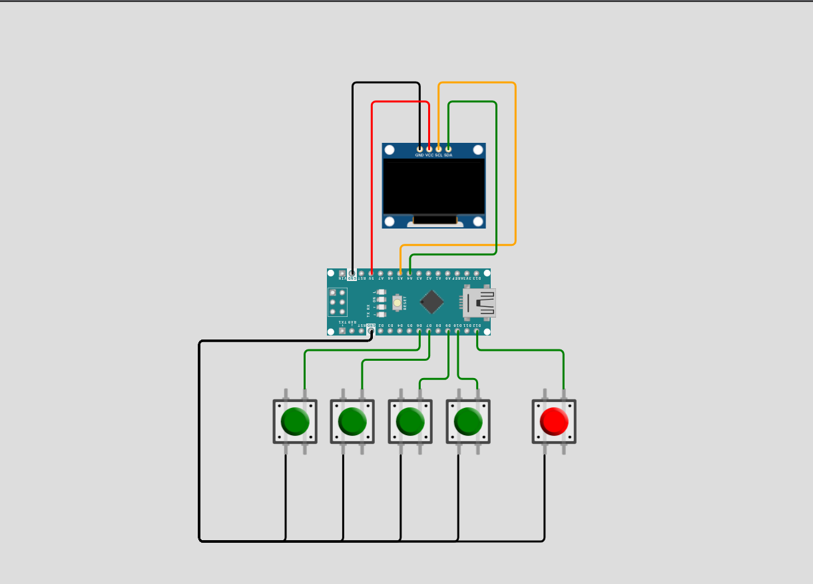

# Arduino Chess 🐴

<p align="center">
  
</p>

<p align="center">
  
  
  
  
</p>


<p align="center">
  <a href="#overview-">Overview🦤</a> •
  <a href="#features-">Features✨</a> •
  <a href="#installation-">Installation🐧</a> •
  <a href="#hardware-">Hardware🪿</a> •
  <a href="#contribution-">Contribute🤝</a> •
  <a href="#developer-guidelines-">Developer Guidelines 🐳</a>
</p>

---

## Overview 🐢

Arduino Chess brings the classic game of chess to your microcontroller. Play as White against a built-in AI opponent (Black) powered by a Minimax algorithm. Move pieces across the board, capture your opponent's pieces, and try to checkmate the AI. The game ends when a king is checkmated or a stalemate is reached.

---

## Features 🦤

- **Classic Chess Gameplay** - Full chess rules including pawn promotion, check, checkmate, and stalemate detection
- **Built-in AI Opponent** - Minimax algorithm with depth-3 search plays as Black
- **Smooth Graphics** - U8g2 library for crisp OLED rendering with piece sprites
- **Responsive Controls** - Button-based cursor movement and piece selection
- **Compact & Efficient** - Runs on Arduino Nano with minimal resources

---

## Installation 🐧

### Prerequisites
- **Arduino IDE 1.8.x or higher** ([Download here](https://www.arduino.cc/en/software))
- USB cable (USB-A to USB-B for Uno, or appropriate for your board)
- Git (optional, for cloning method)

---

### Method 1: Download from GitHub Release (Easiest)

#### Step 1: Download the Code
1. Visit the [Releases page](https://github.com/aydakikio/arduino_chess/releases)
2. Click on the latest release
3. Download the **arduino_chess.ino** file

#### Step 2: Install U8g2 Library
1. Open **Arduino IDE**
2. Go to **Sketch → Include Library → Manage Libraries...**
3. Search for `U8g2`
4. Install **U8g2 by olikraus**

#### Step 3: Open the Project
1. **File → Open**
2. Select `arduino_chess.ino`

#### Step 4: Configure Arduino
1. Connect Arduino via USB
2. **Tools → Board → Arduino Uno**
3. **Tools → Port** → Select your Arduino port

#### Step 5: Upload
1. Click **Upload** (→) or press `Ctrl+U`
2. Game starts immediately!

---

### Method 2: Clone from GitHub

```bash
# Clone repository
git clone github.com/aydakikio/arduino_chess.git
cd arduino_chess/

# Open in Arduino IDE
# File → Open → source_code/arduino_chess.ino
```

Then follow Steps 2-5 from Method 1.

---

## Hardware 🪿

### Required Components
- **Arduino Nano** (or compatible)
- **128x64 OLED Display** (SSD1306/SH1106, I2C)
- **5x Push Buttons**
- **Breadboard and jumper wires**

### Wiring

| Component   | Arduino Pin |
|-------------|-------------|
| OLED SCL    | A5          |
| OLED SDA    | A4          |
| BTN_ACTION  | 12          |
| BTN_UP      | 6           |
| BTN_DOWN    | 9           |
| BTN_LEFT    | 7           |
| BTN_RIGHT   | 10          |

<p align="center">
  
</p>

---

## Known Issues 🐛

- **Display flickering** - Some clone boards may flicker. Try adjusting the U8g2 constructor or adding a delay in the game loop
- **Button debounce** - Rapid presses may register multiple times. Add 0.1µF capacitors across buttons
- **Memory constraints** - Arduino Uno has 2KB SRAM. Complex modifications may cause instability
- **I2C address** - If display doesn't initialize, try address 0x3D instead of 0x3C in the code
- **AI thinking time** - The depth-3 Minimax search may cause a brief pause on the AI's turn; this is expected behaviour

---

## Contribution 🤝

We welcome contributions from the community. Before submitting, please review the guidelines below to ensure your contribution can be integrated smoothly.

### How to Contribute

**For Code Contributions:**
1. Clone the repository: `git clone github.com/aydakikio/arduino_chess.git`
2. Create a feature branch: `git checkout -b feature/descriptive-name`
3. Implement your changes following the coding standards in Developer Guidelines
4. Test thoroughly on physical hardware
5. Commit with descriptive messages: `git commit -m "Fix: Resolve king check detection issue"`
6. Push to your branch: `git push origin feature/descriptive-name`
7. Submit a Pull Request with a clear description of changes and testing performed

**Pull Request Requirements:**
- Code compiles without warnings
- Tested on actual Arduino hardware
- Follows existing code style and naming conventions
- Includes comments for complex logic
- No debug code or commented-out sections

---

### Bug Reports 🐛

When reporting bugs, provide complete technical details to enable efficient reproduction and resolution.

**Required Information:**

```markdown
## Bug Description
[Clear, concise description of the issue]

## Reproduction Steps
1. [First step]
2. [Second step]
3. [Additional steps...]

## Expected Behavior
[What should happen]

## Actual Behavior
[What actually happens]

## Hardware Configuration
- **Board:** [Arduino Uno R3 / Nano / Mega 2560]
- **Display Controller:** [SSD1306 / SH1106]
- **Display Resolution:** [128x64 / 128x32]
- **Interface:** [I2C (address: 0x3C/0x3D) / SPI]
- **Buttons:** [Pin configuration and wiring]

## Software Environment
- **Arduino IDE:** [Version number, e.g., 1.8.19 / 2.0.3]
- **U8g2 Library:** [Version, e.g., 2.34.22]
- **Board Package:** [Version if using third-party boards]
- **OS:** [Windows 10 / macOS 13 / Ubuntu 22.04]

## Build Information
- **Sketch Size:** [e.g., 18,432 bytes (56%) of program storage]
- **Global Variables:** [e.g., 1,247 bytes (60%) of dynamic memory]
- **Compiler Warnings:** [Yes/No - include if present]

## Serial Output / Error Messages

[Paste any error messages or serial monitor output here]

## Additional Context
- Modified code sections (if any)
- Intermittent or consistent occurrence
- Photographs of physical setup
- Logic analyser captures (for timing issues)
- Relevant oscilloscope readings (for hardware issues)

## Attempted Solutions
[What you've already tried to fix the issue]
```

---

### Feature Requests

For new features, open an issue describing:
- Use case and benefits
- Proposed implementation approach
- Memory/performance impact assessment
- Hardware compatibility considerations

---

### Contribution Areas

**High Priority:**
- Performance optimisations (especially AI search speed)
- Memory usage reduction
- Hardware compatibility fixes
- Critical bug fixes

**Accepted Contributions:**
- Castling and en passant implementation
- Improved AI (alpha-beta pruning, better board evaluation)
- Additional display driver support
- Control scheme alternatives
- Sound/buzzer integration
- Move history display
- Two-player (local) mode

**Documentation:**
- Wiring diagrams and schematics
- Troubleshooting guides
- Platform-specific setup instructions
- Code architecture documentation

---

## Developer Guidelines 🐳

### Code Structure
```cpp
// Hardware configuration (display, buttons)
// Constants (#define) — piece types, board size
// Sprite bitmaps (PROGMEM)
// Game state variables
// Function declarations
// setup() and loop()
// Game logic functions (move validation, check detection, AI)
// Drawing functions
```

### Naming Conventions
- **Variables:** `snake_case` (game_over, white_turn, cursor_row)
- **Constants:** `SCREAMING_SNAKE_CASE` (BTN_RIGHT, WHITE_PAWN, BLACK_KING)
- **Functions:** `snake_case` (draw_game, compute_valid_moves, ai_move)

### Key Structures

**Board Representation:**
```cpp
// Positive values = White pieces, Negative = Black, 0 = Empty
int board[8][8];

// Piece type constants
#define WHITE_PAWN   1
#define WHITE_ROOK   2
#define WHITE_KNIGHT 3
#define WHITE_BISHOP 4
#define WHITE_QUEEN  5
#define WHITE_KING   6

#define BLACK_PAWN  -1
// ... (mirror of white, negative values)
```

### Core Patterns

**Move Validation:**
```cpp
void compute_valid_moves(int row, int col) {
  memset(valid_moves, 0, sizeof(valid_moves));
  int piece = board[row][col];
  if (piece == 0) return;

  bool is_white = piece > 0;

  // Example: sliding piece (rook)
  int dirs[4][2] = {{-1,0},{1,0},{0,-1},{0,1}};
  for (auto& d : dirs) {
    int r = row + d[0], c = col + d[1];
    while (r >= 0 && r < 8 && c >= 0 && c < 8) {
      if (board[r][c] == EMPTY) { valid_moves[r][c] = true; }
      else {
        if ((board[r][c] > 0) != is_white) valid_moves[r][c] = true;
        break;
      }
      r += d[0]; c += d[1];
    }
  }
}
```

**Input Handling with Debouncing:**
```cpp
unsigned long now = millis();
if (now - las_btn_time < 150) return;  // 150ms debounce

if (digitalRead(BTN_UP) == LOW) {
  if (cursor_row > 0) cursor_row--;
  las_btn_time = now;
}
```

**Minimax AI:**
```cpp
int minimax(int depth, bool maximizing) {
  if (depth == 0) return evaluate_board();

  int best = maximizing ? -9999 : 9999;

  for (int from_row = 0; from_row < 8; from_row++) {
    for (int from_col = 0; from_col < 8; from_col++) {
      compute_valid_moves(from_row, from_col);

      for (int to_row = 0; to_row < 8; to_row++) {
        for (int to_col = 0; to_col < 8; to_col++) {
          if (!valid_moves[to_row][to_col]) continue;

          // Simulate move, recurse, undo
          int captured = board[to_row][to_col];
          board[to_row][to_col] = board[from_row][from_col];
          board[from_row][from_col] = EMPTY;

          int score = minimax(depth - 1, !maximizing);
          if (maximizing) best = max(best, score);
          else            best = min(best, score);

          board[from_row][from_col] = board[to_row][to_col];
          board[to_row][to_col] = captured;
        }
      }
    }
  }
  return best;
}
```

**Game State Management:**
```cpp
void loop() {
  if (!game_over) {
    if (white_turn) {
      handle_inputs();  // Human plays as White
    } else {
      draw_game();
      ai_move();        // AI plays as Black
    }
    draw_game();
  } else {
    draw_game_over();
    if (digitalRead(BTN_ACTION) == LOW) {
      reset_game();
      delay(200);
    }
  }
}
```

**U8g2 Display:**
```cpp
U8G2_SH1106_128X64_NONAME_2_HW_I2C u8g2(U8G2_R0, -1, A5, A4);
// U8G2_R0 = no rotation
// -1 = no reset pin
// A5 = SCL, A4 = SDA

void draw_game() {
  u8g2.firstPage();
  do {
    draw_game_board();          // Checkerboard pattern
    draw_pieces();              // XBM bitmaps from PROGMEM
    if (white_turn) draw_cursor();  // Cursor + valid move hints
    draw_panel();               // Side panel (turn info, selection)
  } while (u8g2.nextPage());
}
```

### Best Practices

**Memory Management:**
- Arduino Uno: 32KB Flash, 2KB SRAM
- Store piece sprites in PROGMEM: `const unsigned char sprite[] PROGMEM = {...}`
- Use `memset` / `memcpy` for board state operations
- Avoid dynamic memory allocation

**Performance:**
- Use `millis()` for debouncing, not `delay()`
- Clear `valid_moves` with `memset` after each move
- AI depth is set to 3 — increasing it will significantly slow response time

### Testing Checklist
- [ ] Compiles without errors/warnings
- [ ] All pieces move according to chess rules
- [ ] Check and checkmate detection works correctly
- [ ] Stalemate detection works correctly
- [ ] Pawn promotion triggers at correct rows
- [ ] AI makes a legal move every turn
- [ ] Game resets cleanly after game over
- [ ] Button debouncing prevents double-moves
- [ ] Display renders cleanly (no artefacts)

### Common Pitfalls
❌ Don't forget to `memset(valid_moves, 0, ...)` after move execution  
❌ Don't skip the undo step in Minimax — it corrupts board state  
❌ Don't increase Minimax depth without testing for freeze/timeout  
❌ Don't forget to call `check_pawn_promotion()` after every move  
✅ Use `millis()` for timing and debouncing  
✅ Always simulate moves and verify they don't leave the own king in check  
✅ Use `PROGMEM` for all sprite bitmaps to save SRAM  
✅ Use `u8g2.drawXBMP()` for rendering PROGMEM bitmaps  


---
<p align="center">
  <a href="#arduino-chess-">Back to top ↑</a>
</p>
